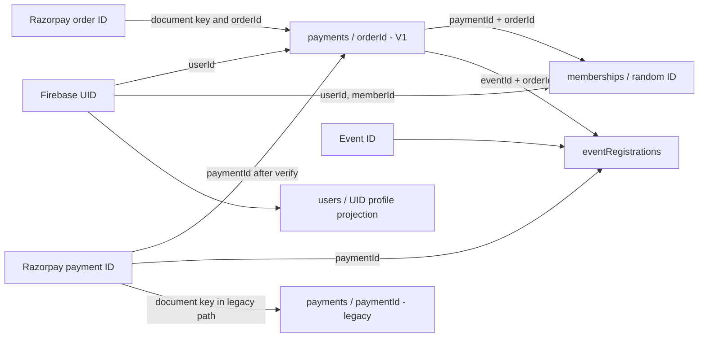

# ANX Club — Phase 2 Payment and Membership Schema Audit

**Scope:** read-only inspection of payment, membership, event registration, authorization, reporting, and their UI dependencies. This report describes repository code, not live Firestore contents or deployed production behavior.

**Audit method:** static source and configuration inspection. No payment flow was executed; no Firestore data was read or written; no automated tests were run for this audit. No secrets or environment values were inspected or reproduced. “Active route” below means a route located beneath the active Next.js `src/app/api` tree. Deployment routing and deployed Firestore rules were not independently verified.

## 1. Executive summary

Payment and membership data currently has multiple competing representations. The V1 payment endpoints write pending order documents keyed by Razorpay order ID; the root legacy Razorpay endpoints write verified payment documents keyed by Razorpay payment ID; a duplicate route implementation exists under `src/modules/module3/app/api` and is not in the active Next route tree. Memberships are written as random-ID documents in the V1 flow, as random-ID documents with a different plan/status representation in the legacy root flow, and are read by one dashboard service as `memberships/{uid}`. User profile membership fields are also used as a separate current-state projection.

The highest-impact confirmed issues are:

1. **Checkout response contract mismatch:** V1 create-order returns `orderId` and a rupee amount, while the membership and event checkout components consume `order.id` and `order.amount` as a Razorpay order object. This can leave the checkout order ID undefined and passes an amount in the wrong unit if used as-is.
2. **Membership fulfillment is not idempotent:** every valid repeat V1 verification can reset the user's expiry from the current date and create another membership document.
3. **Membership writer/reader mismatch:** payment fulfillment writes random document IDs and fields such as `plan`/`endDate`; the Module 2 membership service reads a fixed UID document and expects `tier`/`expiresAt`.
4. **Legacy payment routes remain unauthenticated:** root `/api/razorpay/order` and `/api/razorpay/verify` do not enforce Firebase ownership, and legacy verification trusts body-supplied user identity and amount.
5. **The V1 event payment record has no `paymentType` field.** The verification route selects its membership branch by `paymentType === "membership"` and otherwise enters its event flow. Event data must therefore be correctly supplied, and schema typing does not enforce purpose.

No canonical payment history endpoint or student payment history UI was found. Refund, cancellation, webhook, and payment-failure persistence were not found. The recommendations below are proposals only; they require business and teammate decisions before implementation.

## 2. Scope, evidence, and interpretation

Paths in this report are repository-relative to `ANX-CLUB-main`. Confirmed code paths were inspected under `src/app`, `src/lib`, `src/modules`, `src/components`, `firestore.rules`, and the project PRD documents. Firestore Admin SDK calls are server-side and bypass Firestore client security rules. The rules file is only a checked-in policy; whether it is deployed and matches the checked-in version is **unable to verify**.

`src/modules/module3/app/api/...` duplicates route-like files but is outside the active Next.js App Router root (`src/app/api`). Unless some separate custom build wires it, these nested files are **not active Next.js routes**. The root `src/app/api/razorpay/...` legacy endpoints, by contrast, are in the active route tree.

Findings use these labels:

- **Confirmed in code:** directly visible in an inspected implementation.
- **Partially implemented:** some relevant behavior exists, but it is incomplete or inconsistent.
- **Not implemented:** no implementation was found in the inspected repository paths.
- **Unable to verify:** requires deployed environment, database contents, or runtime observations.

## 3. Existing payment schema

### 3.1 V1 payment/order documents

**Path:** `payments/{razorpay_order_id}`. **Writer:** `POST src/app/api/v1/payments/create-order/route.ts` (`POST`). The pending record is created only after the provider order call succeeds. The shared provider helper is `src/lib/payments/razorpay.ts` (`createRazorpayOrder`), which submits `Math.round(amount * 100)` to Razorpay as paise.

| Field | Observed value/type | Purpose and lifecycle |
|---|---|---|
| `orderId` | string, provider order ID | Same as document ID; set at create time; read in verification. |
| `userId` | string, Firebase UID | Derived from the authenticated payment request; checked against the authenticated UID on verification. |
| `amount` | number, INR major units (e.g. 149, 999, event price) | Server-selected amount saved at order creation; read to create membership and event-registration records and to send receipts. It is not the provider's paise amount. |
| `currency` | string, `"INR"` | Set at order creation. |
| `status` | string, initially `"pending"`, then `"paid"` | Set by server route, not the checkout UI. No paid-state lookup against Razorpay is made in this route; the route verifies the HMAC signature and local ownership. |
| `paymentType` | string, `"membership"` | Present for membership orders only. Missing from event orders. |
| `billingPeriod` | string, generally `"monthly"` or `"annual"` | Present for membership orders; used to choose price and expiry. Any non-`monthly` value is priced as annual. |
| `eventId` | string | Present for event order; used to bind verification to the event. |
| `eventTitle` | string | Present for event order. |
| `createdAt` | Firestore server timestamp | Set on create; no expiry or cleanup path found. |
| `paymentId` | string, Razorpay payment ID | Added on verification. |
| `verifiedAt` | Firestore server timestamp | Added on verification. |

No `id` field, provider `order.amount` in paise, `paidAt`, `updatedAt`, idempotency key, refund fields, failure reason, or verification-attempt record is written on this V1 path. The route returns `{success, orderId, amount, currency, keyId}`; returned `amount` is the major-unit INR value.

**Readers/updaters:** `POST src/app/api/v1/payments/verify/route.ts` reads the document by submitted order ID; it checks `userId` against authenticated UID and sets `status`, `paymentId`, `verifiedAt`. For events, it reads and updates inside a Firestore transaction. Membership fulfillment updates payment outside a transaction. No student payment history reader was found. Admin analytics reads payment documents (see section 14).

### 3.2 Legacy root payment records

**Order endpoint:** `POST src/app/api/razorpay/order/route.ts` (`POST`). It accepts client-provided amount/currency and optional user/payment metadata, creates a Razorpay order (using a dummy credential fallback in code when configured credentials are absent), and returns the provider order. It does **not** persist a pending order document. This endpoint has no Firebase authentication check.

**Verification endpoint:** `POST src/app/api/razorpay/verify/route.ts` (`POST`). It verifies an HMAC using the Razorpay secret, then uses a Firestore transaction on `payments/{razorpay_payment_id}`. If that document is absent, it writes approximately:

```text
userId: body userId or "anonymous"       string
paymentId: Razorpay payment ID           string
orderId: Razorpay order ID               string
amount: body amount, default 0            number-like, client-supplied
paymentType: body paymentType or "Unknown" string
status: "success"                         string
timestamp: ISO string                     string
clientProcessed: true                     boolean
```

For a user and a `paymentType` containing “Premium”, the same transaction updates `users/{userId}` and creates `memberships/{autoId}`. This route is in the active route tree but does not authenticate the caller or bind the signed order to an authenticated Firebase UID. Its document key and field schema conflict with V1. An exact duplicate payment ID avoids a second write through the transaction's document-exists check, but the backend does not fetch a provider payment to establish capture state, and client-supplied amount/identity remain untrusted.

### 3.3 Duplicate nested route implementation

`src/modules/module3/app/api/razorpay/order/route.ts` and `.../verify/route.ts` contain another older implementation. They are outside the active App Router root. The order route uses client-supplied amount and does not write a pending payment. The verify route writes payment-ID-keyed `success` records and uses plain string comparison for signature checking. Treat as **duplicate/inactive source**, not as a confirmed deployed route. It can still confuse future maintenance if copied or wired later.

### 3.4 Other payment-like records

- No `transactions` collection or dedicated immutable verification/audit collection was found.
- No webhook route or webhook delivery record was found. `RAZORPAY_WEBHOOK_SECRET` appears in the example environment template, but no webhook handler was found.
- `src/app/api/v1/mentors/[id]/book/route.ts` stores `amount`, `isPaid`-derived `status`, and caller-supplied `paymentId` on `mentorRequests`; `src/app/(dashboard)/mentors/page.tsx` can create values like `PAY_MEN_<timestamp>`. This is a separate mock/payment-like schema, not Razorpay payment fulfillment. It must not be counted as verified payment evidence.
- Paid event registration also stores payment fields directly on `eventRegistrations` rather than using that collection as the payment ledger.

## 4. Existing membership schema

### 4.1 V1 membership fulfillment

After V1 verification, `src/app/api/v1/payments/verify/route.ts` updates `users/{uid}` using merge with:

| Field | Type/example | Use |
|---|---|---|
| `uid` | string, Firebase UID | User identity projection. |
| `membershipType` | string, `"premium"` | Current premium flag consumed by profile and event pricing logic. |
| `membershipExpiry` | ISO date string | Current expiry projection; created from server `Date`. |
| `role` | string, `"Premium Member"` | Role-like display/access field; read in UI and premium checks. |
| `updatedAt` | Firestore server timestamp | Set by fulfillment. |

It then creates **`memberships/{autoId}`**, not `memberships/{uid}`, with:

| Field | Type/example | Use |
|---|---|---|
| `id` | string, generated Firestore document ID | Mirrors document ID. |
| `userId`, `memberId` | strings, Firebase UID | Both point to owner. |
| `plan` | string, `monthly_149` or `annual_999` | Combines cadence and price in a label. |
| `status` | string, `active` | Set after this route's signature/ownership checks. |
| `startDate`, `endDate` | ISO date strings | Entitlement interval. `endDate` matches calculated profile expiry. |
| `razorpayPaymentId`, `orderId` | strings | Links to provider payment/order. |
| `amount` | number in INR major units | Copied from pending payment record. |
| `createdAt` | Firestore server timestamp | Creation time. |

No membership `tier`, `expiresAt`, `billingPeriod`, renewal number, or `updatedAt` is set in this document. No existing membership record is queried or updated; every verification creates a new random-ID record.

### 4.2 Legacy membership fulfillment

Root legacy verification writes `users/{userId}` membership fields and creates `memberships/{autoId}` with `id`, `userId`, `plan: "Premium"`, `status: "active"`, ISO `startDate`/`endDate`, provider IDs, `amount`, and ISO `createdAt`. This differs from V1 (`monthly_149`/`annual_999`, Firestore timestamp `createdAt`) and also uses random IDs.

The admin user-update API (`src/app/api/v1/admin/users/update/route.ts`) can update `users/{targetUid}` membership fields (`membershipType`, `membershipExpiry`) without creating or updating a corresponding membership document or payment. Admin membership management reads that profile projection. Thus profile state and membership history can disagree.

### 4.3 Membership reader mismatch

`src/modules/module2/services/membershipService.ts` (`getMembership`) reads exactly `memberships/{userId}` and expects `MembershipInfo` fields including `tier`, `status`, and `expiresAt`. It enriches a record with `isPremium` and an `upgradeCTA`. V1 and root legacy writers create random document IDs and use `plan`/`endDate`, so this reader will not find those records at the UID path and would not recognize their fields even if separately queried. It falls back to static Module 2 sample data (`src/modules/module2/data/users.ts`). This fallback can mask missing production-shaped membership records during UI testing.

Separately, active membership UI/profile logic reads fields from `users/{uid}` (including `membershipType`, `membershipExpiry`, and role). The AuthContext expiry check can downgrade its in-memory user data to Free after expiry; no matching database write was found in that client-side path. This projection is not a substitute for membership history.

### 4.4 UID keying conclusion

Membership records are **not consistently keyed by Firebase UID**: current payment writers use generated IDs; Module 2 reads by UID; the user profile is keyed by UID. `userId` and `memberId` fields relate generated membership records back to the UID, but no shared unique constraint enforces one current membership or prevents duplicates.

## 5. Collection/path inventory

| Collection/path | Current purpose | Keying and principal fields |
|---|---|---|
| `payments/{orderId}` | V1 pending/verified orders | Order ID; UID, INR amount, status; membership or event metadata. |
| `payments/{paymentId}` | Root legacy verified payment | Payment ID; user, order, amount, `paymentType`, `success`, ISO timestamp. Same collection, different key convention/schema. |
| `memberships/{autoId}` | V1 and legacy membership history-like records | Random ID; UID references, plan/status/dates/payment references; schema differs by writer. |
| `memberships/{uid}` | Module 2 reader's expected current membership | Fixed UID key; expects tier/status/expiresAt; no matching payment writer found. |
| `users/{uid}` | Profile/current membership projection | `membershipType`, `membershipExpiry`, role; also other profile fields. |
| `eventRegistrations/{autoId}` | V1 paid event registration | Event/user, `paymentStatus`, order/payment IDs, amount, registration timestamps/status. |
| `eventRegistrations/{eventId}_{uid}` | Older free registration route | Deterministic event/user key; `paymentStatus: "Free"`, `createdAt` ISO and attendee data. |
| `mentorRequests/{autoId}` | Mentor request, including mock paid-like data | Amount/status/payment-like ID; not provider-verified. |

No separate order, transaction, refund, webhook, or payment-history collection was found.

## 6. Status values and actual lifecycle

| Entity/field | Exact value(s) found | Trigger / writer | Subsequent transition or reader |
|---|---|---|---|
| V1 `payments.status` | `pending` → `paid` | `create-order` writes `pending`; verify writes `paid` after authenticated UID, HMAC, and order document checks. | Admin analytics reads paid records. No failure, cancellation, refund or provider capture reconciliation update found. |
| Legacy `payments.status` | `success` | Root legacy verify writes `success` if payment-ID doc does not exist after HMAC check. | Different from V1 `paid`; schema readers/report filters may omit it. |
| Membership `status` | `active` | V1 and root legacy verify create membership after their respective checks. | Module2 reader accepts active, but expects a different path/schema. |
| Module2/demo membership `status` | `active`, `expired`, `pending` | Static fallback/demo data. | `membershipService` maps status to premium/upgrade prompts. These are not evidence of real payment lifecycle writes. |
| V1 event registration `paymentStatus` | `paid`; free path also has `not_required` in V1 event registration handling | Paid payment verification or free registration logic. | Admin event registration API/UI reads this field. |
| Older event registration `paymentStatus` | `Free` | `src/app/api/events/register/route.ts` writes for the free registration path. | Inconsistent capitalization/meaning relative to `not_required` and `paid`. |
| V1 event registration `status` | `confirmed` | Registration created after successful verification or zero-price registration. | Admin event screen displays registration state. |
| Mock mentor request status | `Approved`, `Pending` | Mentor UI sends `isPaid`/status-like fields; API stores request status. | Not payment status; no Razorpay verification. |

**Observed transition summary:** V1 payment `pending → paid`; legacy payment is directly recorded as `success`; membership documents are directly created as `active`; event registration becomes `confirmed` and `paid` (or free value). No code transition to payment `failed`, `cancelled`, `refunded`, `captured`, or membership `inactive` was found in the inspected payment paths. `payment.failed` is surfaced in UI feedback but no persistent payment status update was found. Pending order records can therefore remain pending. `paid` and `active` are separate fields but membership activation is coupled to the verification handler's HMAC result; neither status alone proves provider capture when no provider status lookup/webhook reconciliation exists.

## 7. Amount units and types

| Field | Example | Unit/type | Assignment, storage, and conversion |
|---|---:|---|---|
| Membership monthly price | `149` | INR rupees, JS number | V1 create-order chooses it for exact `billingPeriod === "monthly"`; stored as `payments.amount`. |
| Membership annual price | `999` | INR rupees, JS number | V1 create-order uses it for every other period value; stored as `payments.amount`. UI also displays ₹999. |
| Event price / premium price | Event document value | Intended INR rupees; runtime data type is not validated here | V1 order route reads event Firestore value and stores it unchanged in `payments.amount`. Premium price selected when profile signals premium and value is truthy. |
| Razorpay order amount | e.g. 14,900 paise for ₹149 | Integer paise expected by Razorpay SDK | `src/lib/payments/razorpay.ts:createRazorpayOrder` computes `Math.round(amount * 100)` server-side. Provider returned order is not passed through intact by V1 response. |
| V1 API response `amount` | `149` / `999` | INR rupees, number | Returns local amount, although checkout consumers use Razorpay order-object fields. |
| V1 `payments.amount` | `149`, `999`, event price | INR rupees, number | Read during membership/event fulfillment and analytics; not the provider's paise value. |
| V1 checkout verification body `amount` | UI-provided | Client value; ignored by V1 verifier | The verifier reads amount from the stored order document. |
| Legacy order body `amount` | Client-supplied | Unvalidated number-like value; intended rupees | Root legacy order converts with `Math.round(amount * 100)`. No server-side plan/event price lookup. |
| Legacy `payments.amount` | Client-supplied / default `0` | Number-like, presumed rupees but not enforced | Root legacy verifier trusts body value. No conversion/validation at persistence. |
| Event registration `amount` | Stored order's amount in V1 | INR number | Copied from V1 payment document; admin UI formats as rupees. Older/free path may omit it. |
| Mentor request amount | Mentor rate | JS number, currency semantics depend on UI | Posted by client and stored after `Number(amount)`; paid-like flag is not verified. |
| Admin analytics revenue | Sum of `payments.amount` / estimated totals | Treated as INR by UI/report | `paid`-filtered V1 values are rupees; legacy `success` records may be excluded. Other dashboard/cron calculations use estimates or differing assumptions. |

**Risks:** V1 server-side conversion is present, but the response shape and units are not compatible with the Razorpay checkout consumers. Event document amounts are not type/range validated in the order route. Legacy endpoints trust caller-controlled amounts and accept missing/zero values. `Math.round(amount * 100)` limits binary-float artifacts at conversion, but does not validate decimals, positivity, finiteness, or maximums. A future change should use integer minor units in the canonical data model and convert only at provider/UI boundaries.

## 8. Identifiers and relationships

| Identifier | Generation/use | Relationships / ownership |
|---|---|---|
| Firebase UID | Firebase Auth identity | V1 derives it from payment auth helper; stored as `payments.userId`, membership `userId`/`memberId`, event registration `userId`; root legacy accepts body `userId`. |
| Razorpay order ID | Provider order creation result | V1 payment document ID and `orderId`; verification checks the stored document owner. Event registration stores it. Legacy order endpoint does not persist an order record. |
| Razorpay payment ID | Provider checkout callback | V1 saved as `payments.paymentId`, membership `razorpayPaymentId`, event registration `paymentId`. Legacy is also the payment document ID. |
| Membership ID | Firestore auto document ID | V1/legacy membership document `id`; no uniqueness link to UID; multiple records per user possible. |
| Event ID | Existing Firestore event document ID | Stored on event payment; verification compares requested event ID with payment record; event registration references it. |
| Registration ID | Firestore auto ID in V1 paid path; deterministic `{eventId}_{uid}` in older route | Registration may also reference payment order. |
| Transaction ID | None found | No transaction collection or transaction ID field beyond Firestore transaction mechanism. |



**Ownership conclusion:** V1 payment verification checks the stored order's UID against the authenticated UID. Legacy root payment routes do not. Multiple V1 verification attempts can create multiple membership records attached to the same order/payment; no unique membership/payment constraint exists. A client cannot directly write `payments` or `memberships` under checked-in rules, but Admin SDK routes bypass those rules. The v1 event registration API has additional body/user fallback behavior that belongs to the Events owner and should be reviewed before relying on it as a payment boundary.

## 9. Duplicate processing and idempotency

- **Multiple order requests:** no idempotency key or existing-order reuse was found. Each accepted V1 request calls provider order creation, uses a timestamp-based receipt, and writes a new order document. The UI has a loading state, but that is not a server guarantee.
- **Repeated membership verification:** no status guard, transaction, or membership lookup is done before activating. It updates the profile expiry from “now” and appends another random-ID membership. A retry can duplicate history and alter expiry rather than extend from the current valid expiry.
- **Repeated event verification:** V1 uses a Firestore transaction and checks for an existing registration by `orderId`, then for an existing registration by `(eventId,userId)`. The same-order repeat returns idempotently without incrementing seats again. It still does not require the payment document status to be pending or reconcile provider capture; correctness depends on authenticated ownership and HMAC verification. Distinct orders are blocked after one registration exists.
- **Legacy repeated verification:** transaction keyed by payment ID avoids duplicate first-write for that exact ID. It does not bind the caller to authenticated ownership or query Razorpay capture. Email behavior after transaction may repeat; no complete delivery idempotency record was identified.
- **Concurrent flows:** event seat and registration writes are transactional. Membership profile/payment/membership writes are sequential separate calls, so partial fulfillment is possible if a later write fails. No membership transaction/lease/unique constraint exists.
- **Webhook retries:** not applicable in repository; no handler found.

**Classification:** event idempotency is partially implemented; membership idempotency is not implemented; order creation idempotency is not implemented; provider event reconciliation is not implemented.

## 10. Current payment-to-membership flow

1. `src/app/(dashboard)/membership/page.tsx` offers monthly ₹149 and annual ₹999 options. It calls `src/modules/module3/lib/razorpay.ts` with the selected amount and membership metadata.
2. The helper POSTs to `/api/v1/payments/create-order`. V1 authenticates, chooses the amount server-side based on `paymentType` and `billingPeriod`, creates a provider order, then writes the pending payment document.
3. The V1 response contains `orderId`, `amount` (rupees), `currency`, and `keyId`. The membership page and `src/components/events/PaidEventCheckoutModal.tsx` consume `order.id` and `order.amount` as though the response were a Razorpay order object. **Confirmed contract mismatch.**
4. Razorpay Checkout callback passes order ID, payment ID, signature and supplemental user data to the helper, which POSTs `/api/v1/payments/verify`.
5. V1 verification authenticates, checks required callback fields, verifies the HMAC, loads `payments/{orderId}`, and checks UID ownership.
6. For membership, the handler calculates expiry from current server time (+ one month or twelve months), updates `users/{uid}`, marks payment `paid`, and creates a random-ID `memberships` record. These operations are not one transaction and can be repeated.
7. Dashboard/profile UI reads membership fields from the user profile and client-side expiry logic. Module 2's separate service reads `memberships/{uid}` with a different field contract and may show static fallback data.

**Renewal behavior:** no explicit renewal linkage or current membership read exists in V1 fulfillment. It recalculates from the current time and replaces the profile expiry projection; it does not extend a still-active membership's expiry. Root legacy membership fulfillment adds one year from now, also without reading the current expiry. No scheduled expiry worker or renewal-payment relationship was found.

**Failure/activation:** Checkout failure UI does not persist a failed payment state. V1 membership activation is reached only after local HMAC/ownership checks, but there is no provider payment-status fetch or webhook capture confirmation. Admin membership updates can change profile membership fields without payment. Therefore a membership profile can be active without a corresponding successful payment record, through the admin path; live payment authenticity/state cannot be established from static code alone.

## 11. Timestamps and timezone handling

| Field | Observed type and behavior |
|---|---|
| V1 payment `createdAt` | Firestore server timestamp at order record creation. |
| V1 payment `verifiedAt` | Firestore server timestamp at successful verify update. No `paidAt` or `updatedAt` found. |
| V1 user `membershipExpiry` | JavaScript `Date` converted to ISO string; V1 also sets `updatedAt` server timestamp. |
| V1 membership `startDate`, `endDate` | JavaScript `Date` converted to ISO strings; `createdAt` is Firestore server timestamp. |
| Legacy payment `timestamp` | JavaScript ISO string. |
| Legacy membership start/end/created | ISO strings, unlike V1 membership `createdAt`. |
| Paid event registration `registeredAt` | Firestore server timestamp. Older free registration route uses ISO-string `createdAt`. |
| Module 2 mock `expiresAt` | ISO-like string in static data; no payment writer found. |

V1 expiry uses `Date.setMonth` from the current date for one or twelve months. JavaScript month arithmetic can roll a day near month-end (for example, adding one month to a late-month date may land in the following month); no explicit end-of-month policy is present. The result is serialized to UTC ISO, while computations use the server's local date semantics. Legacy uses `setFullYear`. The intended billing timezone, exact expiry inclusivity, and renewal policy are **unresolved business decisions**. No robust timestamp normalization or migration between strings and Firestore Timestamp was found.

## 12. Refunds, cancellations, and failures

- **Not implemented:** refund API/provider SDK calls, refund records or statuses, partial refund handling, cancellation endpoint, membership revocation/adjustment after refund, payment reconciliation webhook, persisted failed/cancelled payment transition, abandoned pending-order expiry/cleanup.
- **Partially implemented:** checkout can show a failure notification; no corresponding database lifecycle transition was found.
- `RAZORPAY_WEBHOOK_SECRET` being named in an example environment file does not establish webhook functionality.
- Membership remains active unless another path/profile expiry logic changes it; no refund-driven membership deactivation was found.

## 13. Ownership and authorization

### Confirmed protections

- V1 create-order and verify call `authenticatePaymentRequest`; the request UID is derived server-side rather than accepting a user ID as authority.
- V1 verification checks that the order document exists and its stored `userId` equals the authenticated UID.
- V1 verifies the Razorpay signature using the server helper.
- Checked-in `firestore.rules` allow owner/admin reads of payment records, deny client payment writes, and limit membership writes to admins. User-owned update rules restrict changing role/membership/expiry fields.
- V1 event verification checks stored event and owner association before recording registration.

### Gaps and boundaries

- Root legacy `/api/razorpay/order` and `/api/razorpay/verify` do not use payment Firebase authentication. Legacy verification accepts `userId`, `amount`, and `paymentType` from request body.
- Admin SDK server code bypasses Firestore rules; each API route must enforce its own identity/role checks. Admin membership profile update does not also update payment/history documents.
- V1 verify does not fetch the Razorpay payment to check captured/settled state or amount/currency against the order. HMAC validation alone is not a provider-state reconciliation step.
- Event UI/API simulation paths can submit paid-like fields to event registration. Their role and deployment use need review by Events owner.
- Deployment of the checked-in rules and exact production route exposure are **unable to verify**.

## 14. Scalability and database access

- Admin analytics reads the `payments` collection and filters/sums records in application code; its `paid` filter can omit legacy `success` records. No pagination or date window was found on this aggregation path.
- Cron analytics reads active memberships and computes an MRR estimate; the inspected calculation divides membership amount by 12 without differentiating monthly versus annual cadence. The membership documents encode cadence inconsistently (`plan` labels in V1, generic `Premium` in legacy).
- No student payment history query or API was found. Membership records are not efficiently addressable as one user's current record through the Module 2 UID-path reader.
- Event registration duplicate checks query by `(userId,eventId)` and by `orderId`; required composite index deployment was not verified. `firestore.indexes.json` should be checked against deployed indexes before relying on these queries at scale.
- Event verification performs multiple reads inside a transaction; this is intentional for seat and registration consistency. Membership fulfillment uses separate writes and has race/partial-failure risk.
- No retention policy, pagination, sharding, ledger partitioning, or pending-order cleanup was found. Full collection reads and unbounded admin aggregation will become increasingly costly as records grow.

## 15. Frontend and admin dependencies

| Consumer | Data/API dependency | Schema-change impact |
|---|---|---|
| `src/app/(dashboard)/membership/page.tsx` | Displays ₹149/₹999; calls module3 Razorpay helper; expects checkout result `id`, `amount`, `currency`; relies on profile role to block premium members. | Response mismatch currently exists; plan display and current-membership projection need compatibility. |
| `src/modules/module3/lib/razorpay.ts` | Posts amount/currency and extra data to V1; verification forwards callback and user metadata. | Helper contract must be versioned with server changes; client values must not become authoritative. |
| `src/lib/razorpay.ts` | Duplicate helper implementation. | Avoid changing only one copy without determining actual imports. |
| `src/components/events/PaidEventCheckoutModal.tsx` | Uses V1 order result as provider object; also has simulated payment/register branch and posts registration/payment-like data. | Events owner must coordinate registration and payment ledger changes. |
| Auth/profile contexts (`src/modules/module3/components/AuthContext.tsx`, duplicate `src/components/AuthContext.tsx`) | User `membershipType`, `membershipExpiry`, role; client expiry presentation/downgrade. | User profile projection field names and expiry semantics are shared contracts. |
| Module 2 `membershipService` and dashboard | Reads `memberships/{uid}` and expects `tier/status/expiresAt`, with static fallback. | Current writer schema does not satisfy reader; fallback may hide issue. |
| Admin members page and `/api/v1/admin/users`/`users/update` | Reads and toggles user profile `membershipType`/expiry. | Profile state can diverge from membership history/payment ledger. |
| Admin event registrations UI/API | Reads event registration `paymentStatus`, `amount`, `paymentId`, registration dates; formats amounts as INR. | Multiple registration schema variants require adapter/backfill. |
| Admin analytics and cron analytics | Reads `payments.amount/status`, memberships `status/amount/plan`. | V1/legacy status, key, and cadence differences affect revenue/MRR. |
| `src/lib/api.ts` `paymentsApi` | Typed helper describes create order with `membershipType`; no call sites found in search. | Appears unused and its request contract differs from V1 route (`paymentType`/`billingPeriod`). |
| Mentor booking UI/API | Stores client-supplied amount and payment-like identifiers on mentor requests. | Keep separate from verified payment ledger unless product decides otherwise. |

No dedicated student payment history screen/API was found.

## 16. Legacy compatibility and migration risks

The V1 path is order-keyed and uses `pending`/`paid`; root legacy path is payment-ID-keyed and uses `success`. Both share `payments`, preventing a single assumed document shape or key convention. Membership history has random document IDs but the Module 2 reader expects UID keying. `users/{uid}` fields are a third current-state representation. Event registration records contain another copy of payment references and amounts. Mock/demo and mentor payment-like records add values that must not be treated as settled financial history.

Risks for future migration include:

1. A naïve reader switch can hide older `success` records or random-ID membership documents.
2. Re-keying payment documents can collide or break order verification references.
3. Replacing membership fields can break profile, admin, event pricing, dashboard, and report consumers.
4. Backfilling from `payments.amount` cannot assume consistent unit, status semantics, or trustworthy legacy client-supplied values.
5. Repeated membership verification may already have generated duplicates; migration needs a reconciliation rule rather than blindly selecting one.
6. Historical timestamps mix Firestore Timestamp and ISO strings.
7. Event registration is owned by another module and retains payment fields; changing only payment schema can break attendee/admin views.

**Recommended compatibility principle:** preserve existing documents; build a dry-run inventory and explicit mapping by source schema; add a read adapter for both legacy and canonical shapes during migration; dual-write only after approval and with idempotent reconciliation; switch consumers incrementally; retain rollback reads until counts and financial reconciliation agree. Do not destructively re-key or delete historical records as part of the first migration.

## 17. Severity-ranked problems discovered

| Severity | Finding / status | Consequence | Recommendation (proposal only) | Approval |
|---|---|---|---|---|
| **P0** | V1 create-order return shape/amount does not match checkout consumers (**confirmed**) | Checkout may receive undefined provider order ID and a rupee value where paise is expected. | Agree on an API contract matching provider requirements; validate both membership and event callers before implementation. | Payments owner + Events owner; coordinate with Payment UI owner. |
| **P0** | Root legacy Razorpay endpoints are unauthenticated and trust client identity/amount (**confirmed**) | Cross-user attribution and amount manipulation risk if reachable. | Decide whether to retire, gate, or secure legacy routes; audit all consumers/deployment references first. | Payments + Auth owner. |
| **P1** | V1 membership verification is replayable/non-idempotent (**confirmed**) | Duplicate membership docs; expiry resets from now; partial profile/payment/history writes possible. | Define fulfillment idempotency keyed by order/payment and transactional write strategy. | Payments owner + Auth/data owner. |
| **P1** | Membership random-ID writer vs UID-keyed reader and incompatible fields (**confirmed**) | Dashboard can miss paid membership or show fallback data. | Approve one canonical identity/path and update reader/writer together with compatibility plan. | Payments + Student Dashboard owner. |
| **P1** | No provider status/amount reconciliation beyond signature (**confirmed**) | Local fulfillment does not independently assert provider captured state and matching amount/currency. | Decide capture/webhook/reconciliation model and trust boundary. | Payments owner + company finance/business. |
| **P1** | Event registration simulation/payment-like path and multiple registration schemas (**confirmed/partially implemented**) | Paid registration status may be represented outside verified payment lifecycle; reporting can diverge. | Events owner to define one authoritative paid-registration flow. | Events owner + Payments owner. |
| **P1** | Admin profile membership mutation has no matching payment/history record (**confirmed**) | Profile access state and financial entitlement history diverge. | Decide whether admin grants are explicit comp/manual-grant records distinct from paid plans. | Admin/Auth + Payments + business. |
| **P2** | Status and key conflicts: `paid` vs `success`; order ID vs payment ID; `Free` vs `not_required` (**confirmed**) | Reports, histories, reconciliation can omit or misclassify records. | Approve canonical enums and migration mapping. | Payments + Events + Admin reports. |
| **P2** | Legacy and V1 timestamp/amount formats differ; billing expiry month arithmetic unclear (**confirmed**) | Date displays/reporting and billing boundaries may disagree. | Decide time policy, money representation, and normalization. | Payments + business/finance. |
| **P2** | Analytics scans collections and MRR calculation ignores cadence (**confirmed**) | Cost growth and inaccurate recurring-revenue estimate. | Add paginated/period-aware aggregates after schema/metric definition. | Admin/report owner + Payments. |
| **P3** | No persisted failed/cancelled/refund lifecycle or webhook reconciliation (**not implemented**) | Pending orders stay pending; no refund or failure history/revocation. | Define lifecycle and operational support policy before adding statuses. | Payments + business/finance. |

## 18. Recommended canonical payment schema (proposal, not current behavior)

Use one payment aggregate keyed by the provider order ID:

```text
payments/{razorpayOrderId}
  schemaVersion: number
  provider: "razorpay"
  orderId: string                 // equals document ID
  paymentId: string | null        // provider payment ID after confirmation
  ownerUid: string                // Firebase UID from server auth
  purpose: "membership" | "event"
  targetId: string | null         // plan ID or event ID
  planId: string | null
  amountMinor: integer            // paise, e.g. 14900 or 99900
  currency: "INR"
  status: approved payment enum
  createdAt: Firestore Timestamp
  updatedAt: Firestore Timestamp
  verifiedAt: Firestore Timestamp | null
  paidAt: Firestore Timestamp | null
  idempotencyKey: string
```

Keep provider payloads minimal and avoid storing secrets or raw credentials. Store any audit/verification metadata needed for support only after deciding retention and privacy policy. Event registration should reference the payment document and not independently become the financial source of truth. Whether payment attempts need a separate append-only event collection is a business/audit decision.

**Compatibility:** existing V1 order IDs already key the V1 records, so those can map most directly. Legacy payment-ID-keyed docs need an explicit import/alias mapping retaining both order and payment identifiers. `status: success` needs a reviewed conversion; do not automatically equate it to a provider-captured payment without evidence. Existing major-unit amounts require an audited ×100 conversion only when their source/meaning is verified.

## 19. Recommended canonical membership schema (proposal)

Store membership grants/history separately from the user profile projection, with a stable record ID and explicit payment relationship:

```text
memberships/{membershipId}
  schemaVersion: number
  membershipId: string
  ownerUid: string
  planId: string                 // e.g. monthly or annual plan identifier
  billingPeriod: "monthly" | "annual"
  status: approved membership enum
  amountMinor: integer
  currency: "INR"
  startsAt: Firestore Timestamp
  expiresAt: Firestore Timestamp
  paymentOrderId: string | null
  paymentId: string | null
  createdAt: Firestore Timestamp
  updatedAt: Firestore Timestamp
```

Prefer one membership-history record per paid grant/renewal. Define how one current entitlement is derived (query/index or an explicit user projection). Keep `users/{uid}` membership fields only as a documented compatibility/access projection, updated atomically or reconciled from the membership record. Admin/manual complimentary grants should have an explicit source/reason and no fabricated payment reference.

This is a proposal. The team must choose whether membership IDs are generated IDs or deterministic per purchase, whether overlapping memberships can coexist, and how refunds/admin grants affect entitlement.

## 20. Recommended status lifecycle (proposal)

Use separate enums for payment, membership, and event registration. A candidate payment lifecycle is `created → pending → paid` or `failed`; cancellation and refunds should be added only with their precise provider/business semantics. A candidate membership lifecycle is `active → expired`, with `revoked` only if approved for refunds/admin action. Event registration can remain `confirmed/cancelled` independently and refer to payment status rather than mirror it. These are **recommendations**, not observed transitions. Define whether provider `authorized` differs from captured/paid, which event enables fulfillment, and what late/duplicate callbacks do before adopting the enum.

## 21. Recommended amount and timestamp representation (proposal)

- Store all money as integer minor units (`amountMinor` in paise for INR) and an ISO currency code. Validate integer, positive/allowed amount, currency, and plan/event pricing server-side.
- Keep UI display in rupees using an explicit formatting conversion. Convert to paise at the provider boundary; return the provider order fields with a documented unit contract.
- Store instants as Firestore Timestamp consistently; serialize to ISO only at API/UI boundaries.
- Define monthly and annual expiry semantics (calendar month/year, end-of-month rule, timezone, and inclusive/exclusive expiry) and calculate renewals from the agreed entitlement boundary, not an implicit current time.

## 22. Recommended migration and rollout (proposal only)

1. Obtain business and teammate decisions listed below; no migration should precede them.
2. Inventory actual Firestore documents in a read-only/dry-run process, counting each schema variant, status, amount range/type, duplicate UID/order/payment relationships, and timestamp type. This audit did not read live data.
3. Write and review deterministic mapping rules for V1 order-keyed, legacy payment-keyed, membership random-ID, and mock/demo records. Exclude mock mentor data from financial history.
4. Prepare a dry-run export/report with expected new canonical records, conflicts, and unresolved records; reconcile totals with finance/admin before writing.
5. Implement an approved compatibility adapter and idempotent fulfillment in a separate, reviewed task; preserve old fields/records during transition.
6. Dual-read/dual-write only with explicit rollout/rollback criteria and monitoring. Backfill in batches with checkpoints and retry safety.
7. Switch dashboard/admin/event consumers incrementally; compare old/new counts and revenue; keep rollback reads until reconciliation is signed off.
8. Retire legacy routes and old readers only after usage/deployment references and historical needs are verified.

No migration, dry-run data access, or implementation was performed in this audit.

## 23. Teammate coordination and unresolved decisions

Based on the project task division document, payment/membership ownership is Sri Nidhi; authentication/admin dashboard/college ownership is Sandharsh; Events/Registrations/Reports is Nandhitha; Student/Mentor is Sai Teja. Confirm these assignments remain current before work begins.

| Decision/dependency | Required participants |
|---|---|
| UID ownership, role semantics, service auth, Firestore rules, removal/gating of legacy routes | Payments owner + Sandharsh (Auth/Admin); rules/deployment owner as applicable |
| Payment order response and checkout contract; pricing and provider-state policy | Sri Nidhi + Nandhitha for event checkout; finance/business for capture/refund rules |
| Event registration/payment references, free status naming, paid simulation boundaries | Sri Nidhi + Nandhitha |
| Membership path/fields and profile projection; dashboard history/expiry display | Sri Nidhi + Sai Teja; Sandharsh for admin/profile APIs |
| Admin grants, revenue/MRR and historical record mapping | Sri Nidhi + Sandharsh + finance/business |
| Student payment history requirements and privacy | Sri Nidhi + Sai Teja + business |

Unresolved questions:

1. Which payment event counts as fulfillment: provider authorization, capture, signed callback plus provider lookup, or webhook-confirmed capture?
2. What are the exact prices and permitted plan IDs/cadences, and should a current membership be extended from its expiry or replaced from purchase time?
3. What is the month-end and timezone rule for expiry?
4. Are admin-issued memberships complimentary/manual grants, and how should they appear in financial vs entitlement reports?
5. Should event checkout be part of the same verified payment ledger, and should Student Head/external payments be excluded entirely?
6. What historical legacy records can be trusted as paid, especially where `amount` and `userId` came from the client?
7. What refund, cancellation, chargeback, and failed-payment policies/statuses are required?
8. Which payment history and admin reporting retention/pagination requirements apply?
9. Are the root legacy endpoints currently deployed or referenced by any client outside this repository?
10. Is `memberships/{uid}` intended to be the canonical current record, or should current status be a projection over membership history?

## 24. Final audit boundary

This report records the state and risks visible in source. It does not establish the contents of Firebase, the state of production credentials, deployed rules, provider dashboards, or route exposure. No source code, database records, Firebase configuration, environment variables, authentication code, Firestore rules, package files, or Phase 1 changes were modified. The only intended project change from this audit is this report. **Phase 3 has not started.**
