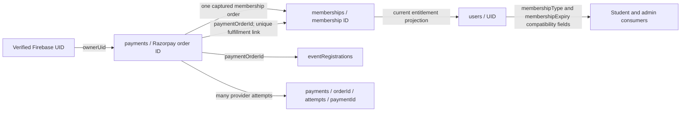

# ANX Club — Phase 3 Task 1: Canonical Payment and Membership Schema Review

**Review status: RECOMMENDATION — NOT APPROVED FOR IMPLEMENTATION**  
**Scope:** schema and dependency review only. No application code, Firebase/Firestore data, rules, indexes, configuration, or dependencies were changed. No migration or payment was run.

This review reads the Phase 3 implementation plan and all three Phase 2 reports, then checks the relevant current writers/readers. It does not establish the contents of live Firestore or deployed configuration. Every schema below is a recommendation until approved by the company and affected teammates.

## 1. Review summary

The plan's core direction is suitable for review: an order-keyed payment aggregate, one membership history record for each paid membership term, integer paise amounts, and the user document as a current-state projection. Four design details should be resolved before approval:

1. **Order creation idempotency:** putting an `idempotencyKey` on `payments/{orderId}` alone cannot prevent duplicate provider orders because the order ID is not known until Razorpay creates it, and Firestore does not enforce uniqueness on arbitrary fields. Decide on a deterministic request-reservation record or another concurrency-safe mechanism.
2. **Payment attempts:** one Razorpay order can have multiple attempts, so one `paymentId` and one status on the order aggregate cannot preserve every failed/retried attempt. Decide whether to use a child attempts collection.
3. **Payment versus fulfillment state:** a captured payment can exist while membership activation or event registration is still retrying. Keep provider/payment state separate from local fulfillment state.
4. **Membership grant source and renewal chain:** support paid terms and explicitly authorized admin/manual grants without fabricating payment references; retain renewal history without overwriting a prior term.

The proposed records below include these distinctions. The collection names and statuses remain subject to team/company approval.

## 2. Proposed canonical payment schema

### 2.1 Payment order aggregate

**Recommended path:** `payments/{razorpayOrderId}`. Keep the provider order ID as the document ID for compatibility with current V1 verification. Treat each payment document as one order's aggregate and authoritative financial summary, not as proof that payment has been captured merely because it exists.

| Field | Firestore type | Requiredness / rule |
|---|---|---|
| `schemaVersion` | integer number | Required; explicitly version the canonical shape. |
| `provider` | string enum | Required; currently `"razorpay"`. |
| `orderId` | string | Required; equals document ID and provider order ID. |
| `ownerUid` | string | Required; derived from Firebase-verified identity on the server. Never sourced from request-body `userId`. |
| `purpose` | string enum | Required: `membership` or `event`. Server-derived. |
| `planId` | string or null | Required for membership purpose; stable plan identifier, independent of price text. Null for event purpose. |
| `billingPeriod` | string enum or null | Membership only: `monthly` or `annual`; null for event. |
| `eventId` | string or null | Event only; null for membership. |
| `eventRegistrationId` | string or null | Filled after a registration is durably created; null beforehand. |
| `membershipId` | string or null | Filled after membership fulfillment; null for event and before fulfillment. |
| `paymentId` | string or null | Primary/captured Razorpay payment ID once provider evidence is checked. Do not overwrite it with an unverified callback. |
| `amountMinor` | integer number | Required, positive server-selected amount in currency minor units; for INR, paise. Never store rupees in this canonical field. |
| `currency` | string | Required ISO currency code; initially `INR`. |
| `paymentStatus` | string enum | Required; proposed lifecycle below. Set by verified server/provider evidence, not a frontend success message. |
| `providerOrderStatus` | string or null | Last verified provider order status, kept distinct from the app's normalized payment status. |
| `providerPaymentStatus` | string or null | Last verified provider payment status, e.g. a provider-reported state; null until checked. Preserve provider vocabulary for reconciliation. |
| `fulfillmentStatus` | string enum | Required and separate from payment status: proposed `not_started`, `pending`, `completed`, `retry_required`, `not_required`. Use `not_required` only where the order has no local entitlement/registration fulfillment. |
| `requestIdempotencyKey` | string | Required for an order-creation request if this mechanism is approved; scope it to the authenticated owner and request fingerprint. A field alone is not a uniqueness constraint. |
| `createdAt` | Firestore Timestamp | Required; server-assigned. |
| `updatedAt` | Firestore Timestamp | Required; server-assigned on each state change. |
| `verifiedAt` | Firestore Timestamp or null | Null until server verification succeeds. |
| `capturedAt` | Firestore Timestamp or null | Null until provider-confirmed capture. Prefer this precise name over ambiguous `paidAt`. |
| `lastProviderCheckAt` | Firestore Timestamp or null | Null until provider state has been fetched or received through an authenticated webhook. |
| `failureCode` | string or null | Optional; provider/application error code, with personal data excluded. |
| `failureMessage` | string or null | Optional, sanitized operational message; do not store secrets or sensitive provider payloads. |
| `refundedAmountMinor` | integer number | If refund support is approved, initialize to `0` and update only from verified refund evidence. Otherwise omit until that scope is approved. |

`planVersion` or a server-side price snapshot may also be needed if published plan prices can change while old orders remain open. Confirm whether the stable `planId` plus `amountMinor` is sufficient for historical pricing and receipts.

### 2.2 Idempotency and payment attempts (companion records)

**Order-request idempotency:** reserve a request key before calling Razorpay, under a deterministic key scoped to `ownerUid` (for example, a dedicated `paymentRequests/{requestKeyHash}` record). Candidate fields: `ownerUid` string, `requestKeyHash` string, `requestFingerprint` string, `orderId` string or null, `createdAt`/`updatedAt` Timestamps. Reuse with a different purpose/plan/event/amount fingerprint must be rejected. The exact path and retry contract require approval; client identity and amount remain untrusted.

**Payment attempts:** if retry attempts must be auditable, use `payments/{orderId}/attempts/{paymentId}` with `paymentId` string, `orderId` string, `status` string, verified `amountMinor` integer, `currency` string, `createdAt`/`updatedAt` Timestamps, optional `verifiedAt` Timestamp, and a sanitized failure code. The order aggregate then summarizes the successful/authoritative attempt. If the company does not need failed-attempt history, explicitly decide what information may be omitted.

Refund IDs, webhook event IDs, and dispute/chargeback references should not be overloaded into `paymentId`. If refunds/webhooks are approved, define append-only, deduplicated companion records and retention rules as a separately reviewed extension.

### 2.3 Dummy payment example

```json
{
  "path": "payments/order_TEST_001",
  "schemaVersion": 1,
  "provider": "razorpay",
  "orderId": "order_TEST_001",
  "ownerUid": "TEST_USER_A",
  "purpose": "membership",
  "planId": "premium",
  "billingPeriod": "monthly",
  "eventId": null,
  "eventRegistrationId": null,
  "membershipId": null,
  "paymentId": null,
  "amountMinor": 14900,
  "currency": "INR",
  "paymentStatus": "pending",
  "providerOrderStatus": "created",
  "providerPaymentStatus": null,
  "fulfillmentStatus": "not_started",
  "requestIdempotencyKey": "TEST_REQUEST_KEY_A1",
  "createdAt": "Firestore Timestamp (dummy)",
  "updatedAt": "Firestore Timestamp (dummy)",
  "verifiedAt": null,
  "capturedAt": null,
  "lastProviderCheckAt": null,
  "failureCode": null,
  "failureMessage": null,
  "refundedAmountMinor": 0
}
```

This is an illustrative proposed record only. It was not written to Firestore. `TEST_USER_A`, `order_TEST_001`, and the request key are dummy values.

## 3. Proposed canonical membership history schema

**Recommended path:** `memberships/{membershipId}`. Store a distinct term/grant per successful paid renewal; do not overwrite old membership history. For payment-backed grants, a deterministic ID derived from the payment order (for example `mem_order_TEST_001`) can enforce one document path per payment. Firestore has no general unique-field constraint; the deterministic ID and a transaction still need to be used consistently. Admin/manual grants need a different approved deterministic or generated ID.

| Field | Firestore type | Requiredness / rule |
|---|---|---|
| `schemaVersion` | integer number | Required. |
| `membershipId` | string | Required; equals document ID. |
| `ownerUid` | string | Required; Firebase UID from server-authenticated payment or authorized admin grant. |
| `planId` | string | Required; stable plan identifier, not a price-suffixed display label. |
| `billingPeriod` | string enum | Required for paid plans: `monthly` or `annual`; null only for an approved non-period grant if the company allows one. |
| `status` | string enum | Proposed: `scheduled`, `active`, `expired`, `revoked`. Never infer payment capture from membership status. |
| `grantSource` | string enum | Proposed: `payment`, `admin_grant`, `migration`; distinguishes paid terms from manual grants and imported history. |
| `amountMinor` | integer number | Required for paid terms; amount snapshot in paise for INR. An approved complimentary grant may use `0`; do not invent a paid payment link for it. |
| `currency` | string | Required for paid terms; ISO code such as `INR`. Null for a non-financial grant only if explicitly approved. |
| `startsAt` | Firestore Timestamp | Required; the approved entitlement start instant. |
| `expiresAt` | Firestore Timestamp | Required for time-limited terms; end instant under the approved month-end/timezone policy. |
| `paymentOrderId` | string or null | Required for a payment grant; points to `payments/{orderId}`. Null for an approved admin/manual grant. |
| `paymentId` | string or null | Provider payment ID for a payment-backed grant; null for manual grants and until known. |
| `previousMembershipId` | string or null | Links a renewal term to the preceding term; null for the first term. Do not embed an unbounded renewal array. |
| `renewalSequence` | integer number | Optional sequence within the user's approved plan history; define whether this is needed or derive from links. |
| `grantedByUid` | string or null | Admin UID for manual grants; null for automatic payment fulfillment. |
| `grantReason` | string or null | Required if manual-grant policy requires an auditable reason; establish privacy/retention rules. |
| `createdAt` | Firestore Timestamp | Required; server-assigned. |
| `updatedAt` | Firestore Timestamp | Required; server-assigned on state change. |
| `revokedAt` | Firestore Timestamp or null | Null unless a policy-approved revocation occurs. |
| `revocationReason` | string or null | Null unless revocation policy is approved; sanitized and access controlled. |

The `scheduled` status is needed only if approved early renewal begins at a future existing expiry. If that policy is rejected, remove it from the approved enum before implementation. Derive `expired` from timestamps or persist an explicit transition only after the team chooses the read/reporting model. Do not make payment status and membership status equivalent.

### 3.1 Dummy membership example

```json
{
  "path": "memberships/mem_order_TEST_001",
  "schemaVersion": 1,
  "membershipId": "mem_order_TEST_001",
  "ownerUid": "TEST_USER_A",
  "planId": "premium",
  "billingPeriod": "monthly",
  "status": "active",
  "grantSource": "payment",
  "amountMinor": 14900,
  "currency": "INR",
  "startsAt": "Firestore Timestamp (dummy)",
  "expiresAt": "Firestore Timestamp (dummy)",
  "paymentOrderId": "order_TEST_001",
  "paymentId": "pay_TEST_001",
  "previousMembershipId": null,
  "renewalSequence": 1,
  "grantedByUid": null,
  "grantReason": null,
  "createdAt": "Firestore Timestamp (dummy)",
  "updatedAt": "Firestore Timestamp (dummy)",
  "revokedAt": null,
  "revocationReason": null
}
```

This sample assumes capture and activation already occurred; it is illustrative, not a test result or approved policy.

## 4. Relationships and user profile projection



- **Payment to membership:** one captured membership-purpose order may fulfill at most one membership term. Store `membershipId` on the payment and `paymentOrderId` on the membership; create/update both plus the user projection in one Firestore transaction where supported. Enforce uniqueness with a deterministic membership document ID derived from the order or another approved unique constraint. Event-purpose orders must never enter membership fulfillment.
- **Payment to event registration:** registration stores a payment-order reference; payment stores the resulting registration ID. The payment record is financial source of truth. Registration `paymentStatus`/`amount` may remain temporary display projections for Events/Admin compatibility. Free Company Admin events have no payment and should use an approved `not_required` representation. Student Head-created events are external-only per the Phase 3 instruction and must not create internal ANX payment, ticket, or attendee-count records; Nandhitha must approve the enforcement location.
- **Ownership:** V1 payment and membership `ownerUid` must come from the verified Firebase token on the server. Keep Phase 1 `authenticatePaymentRequest` unchanged absent Sandharsh approval. Check the stored order owner on every verification/retry; do not accept body-supplied `userId` as authority.
- **User profile:** `users/{uid}` remains a read-optimized membership projection, not payment history. During compatibility, preserve current `membershipType`, `membershipExpiry`, and any role display fields expected by existing clients. Proposed projection pointer: `currentMembershipId` and a nested/current `{planId,status,startsAt,expiresAt,updatedAt}` snapshot. Derive it from canonical membership history; do not independently grant premium by changing a role string. Sandharsh and Sai Teja must approve field names, date types, access rules, and UI transition.
- **Idempotency:** one stable request key must prevent duplicate order creation for the same authenticated UID and identical request; a request fingerprint must reject reuse for a different purpose/plan/event. A deterministic membership ID/transaction prevents repeat fulfillment. Webhook event-ID deduplication is an additional mechanism, not a replacement for payment-level fulfillment uniqueness.

## 5. Status lifecycle recommendations

These candidate statuses are **not approved**. Separate provider/payment state from fulfillment and entitlement state.

| Record / field | Candidate values | Lifecycle and authority |
|---|---|---|
| Payment `paymentStatus` | `pending`, `authorized`, `captured`, `failed`, `cancelled`, `partially_refunded`, `refunded`, `disputed`, `charged_back` | Starts pending. Server moves to authorized/captured/failed only from verified provider evidence. Cancellation, refund, dispute and chargeback require approved policy and provider evidence. Do not assume each path is linear; preserve last verified provider status. |
| Payment `fulfillmentStatus` | `not_started`, `pending`, `completed`, `retry_required`, `not_required` | Tracks local membership/registration work separately. A captured payment with a failed Firestore write stays captured and retryable; it must not be charged again. Free event has no payment record; its registration can be not-required. |
| Membership `status` | `scheduled`, `active`, `expired`, `revoked` | A captured/approved grant becomes scheduled or active under the chosen renewal rule; active terms expire by approved time policy; revocation only under approved refund/admin rules. `scheduled` is conditional on future-start renewals. |
| Event registration `paymentStatus` | Compatibility projection only: existing `paid`, `not_required`, and legacy `Free`; canonical mapping pending approval | Read from payment/order relationship for paid events. Do not treat a client-provided `paid` value as payment evidence. Normalize `Free` only after backward-compatible readers are ready. |

Current-code values differ: V1 payments use `pending` then `paid`; legacy payment records use `success`; membership writers use `active`; Module 2 mock data also contains `expired` and `pending`; event registration uses `paid`, `not_required`, and legacy `Free`. In particular, existing `paid`/`success` records must not automatically be migrated to `captured` without reconciliation evidence.

## 6. Amount units and conversions

- Canonical persisted financial amounts: integer `amountMinor` in paise for INR (e.g. ₹149 = `14900`; ₹999 = `99900`). `currency` is `INR`.
- The API/provider boundary sends the provider amount in paise. Checkout receives the provider order's `id`, integer `amount` in paise, and `currency`; public key is configuration, not a payment field. Display code converts/ formats minor units as rupees.
- The server chooses plan/event prices. Validate integer minor units, positivity, currency and permitted plan/event price before order creation. Never accept client amount or UID as the authoritative value.
- Existing V1 `payments.amount` and `memberships.amount` are rupee numbers. Root legacy `payments.amount` is body-supplied/weakly typed. Convert only records with verified meaning and type; preserve raw legacy amount/status and flag ambiguous rows for reconciliation. Avoid a blanket `×100` backfill.
- The current response-contract mismatch is a separate checkout prerequisite: the V1 route returns `orderId` and INR `amount`, while known callers use `order.id` and provider paise `order.amount`. Coordinate response fields with both membership and event consumers before implementing the schema.

## 7. Legacy compatibility and migration strategy

| Existing data | Compatibility requirement |
|---|---|
| V1 `payments/{orderId}` with `amount` in INR, `pending`/`paid`, membership or event fields, Firestore timestamps | Preserve the order document ID and raw fields. Add a versioned read adapter; map amount only after numeric/source validation. `paid` is not automatically `captured`. |
| Root legacy `payments/{paymentId}` with `status: success`, body-supplied `userId`/amount and ISO `timestamp` | Preserve payment ID as a separate identifier; map `orderId` only when present and validated. Keep original `status`/raw amount, mark uncertain records for reconciliation, and never infer capture from `success` alone. |
| V1/legacy `memberships/{autoId}` using `plan`, `endDate`, INR `amount`, mixed Firestore Timestamp/ISO `createdAt` | Preserve random document IDs and raw values. Map `userId`/`memberId` to `ownerUid` only after ownership review; map plan/cadence only when determinable. Do not re-key or delete. |
| `users/{uid}` `membershipType`, ISO `membershipExpiry`, role | Keep as a compatibility projection while readers migrate; compare against membership records and resolve mismatches through reviewed reconciliation. Do not change role semantics without Auth/Admin approval. |
| Event registration docs with `userId`, `orderId`, `paymentId`, `paymentStatus`, major-unit `amount`, `registeredAt` or `createdAt` | Maintain legacy reads; add canonical payment reference only after verified match. Preserve `paid`, `not_required`, and `Free` until reports/UI accept normalized values. |
| Module 2 mock/fallback data and mentor mock payment-like values | Exclude from financial backfill. Do not interpret demo values as paid records. Keep fixtures separate from production payment schemas. |

Recommended rollout after separate approvals: read-only inventory and backup; deterministic source-to-canonical mapping; dry-run record and revenue reconciliation; additive compatibility reader; approved canonical writes for new transactions; idempotent, checkpointed backfill only if required; compare counts and aggregates; migrate consumers in owner-approved slices; keep rollback reads and all original records. No step here is authorized by this review.

## 8. Affected files and teammate ownership

Ownership follows the project task division in the Phase 2 reports. File-level ownership for the Module 4 registration UI should be reconfirmed with Nandhitha before edits.

| Area / files to coordinate | Schema dependency | Owner / approval |
|---|---|---|
| `src/app/api/v1/payments/create-order/route.ts`, `src/app/api/v1/payments/verify/route.ts`, `src/lib/payments/razorpay.ts` | Order/payment schema, units, lifecycle, links and fulfillment status. | Sri Nidhi; Sandharsh if auth boundary changes. |
| `src/lib/payments/auth.ts` | UID owner binding. Phase 1 payment-specific verifier must remain intact. | Sandharsh owns Auth; Sri Nidhi coordinates if any change is proposed. No change is required just to define schema. |
| `src/modules/module3/lib/razorpay.ts`, `src/lib/razorpay.ts`, `src/app/(dashboard)/membership/page.tsx` | Checkout response fields, plan/cadence, payment status and price display. | Sri Nidhi; confirm all helper callers before changing either duplicate. |
| `src/components/events/PaidEventCheckoutModal.tsx`, `src/app/api/v1/events/[id]/register/route.ts`, `src/components/RegisterModal.tsx`, `src/modules/module4/components/RegisterModal.tsx`, `src/app/api/v1/events/[id]/registrations/route.ts`, `src/app/(admin)/admin/events/page.tsx` | Event price/payment relation, registration status/amount, free vs paid vs external-only event rules. | Nandhitha (Events/Registrations/Reports) with Sri Nidhi for payment records; confirm module4 component owner. |
| `src/modules/module2/services/membershipService.ts`, `src/modules/module2/types/dashboard.ts`, student membership/dashboard consumers | Membership path, owner UID, status, dates, renewal history, current projection. | Sai Teja; payments writer changes coordinated with Sri Nidhi. |
| `src/app/(admin)/admin/members/page.tsx`, `src/app/api/v1/admin/users/update/route.ts`, `src/app/api/v1/admin/analytics/route.ts`, `src/app/api/cron/analytics/route.ts` | Profile projection, admin grants, reporting amounts/statuses, monthly/annual revenue. | Sandharsh with Sri Nidhi; finance/business for revenue meaning. |
| `firestore.rules`, `firestore.indexes.json` | Owner access and queries for history/idempotency/relationships. | Coordinate with Sandharsh/rules owner and affected data owners before changes. Not changed in this review. |
| `src/app/api/razorpay/order/route.ts`, `src/app/api/razorpay/verify/route.ts` | Legacy payment shape and ownership; migration/read adapter must account for them. | Sri Nidhi + Sandharsh. Inventory external callers before deprecation. |

The Phase 2 report also identified `src/lib/api.ts` `paymentsApi` as a potentially unused helper with a different request type. Confirm call sites before treating it as a supported contract.

## 9. Risks and missing decisions

- **No approved schema yet:** `schemaVersion`, field names, status enum, request-idempotency record and companion attempt records need team approval.
- **Uniqueness:** Firestore has no unique constraint for a field. Agree on deterministic document IDs and transactions; do not rely on an idempotency field alone.
- **Multiple attempts:** decide whether failed attempts must be persisted and visible to admins/students.
- **Provider evidence:** signature authenticity and provider capture are distinct. The V1 code currently verifies HMAC/ownership but does not fetch provider payment state. Define whether captured payment is mandatory before fulfillment and which provider source is authoritative.
- **Business policies:** expiry/renewal and time-zone choices below are not resolved; a future-dated renewal may need `scheduled` membership state.
- **Partial failure:** payment status and fulfillment status must allow a captured payment with a retrying membership/event write without duplicate payment or entitlement.
- **Manual grants:** decide whether admin/complimentary grants belong in the same membership history schema, required reason/approver fields, and how they are excluded from revenue.
- **Refund/dispute scope:** define full/partial refund, dispute, chargeback and entitlement rules; if excluded from current implementation, record OUT OF SCOPE explicitly before adopting those enum values.
- **Migration ambiguity:** legacy amounts/statuses and mixed timestamps may not prove payment; dashboards and analytics can disagree with records. Backfill is a separate approved task with backup and reconciliation.
- **Shared consumers:** role strings, profile membership fields, event registration projections, Firestore rules/indexes and analytics are cross-team contracts; one-sided schema changes can break access or reporting.

## 10. Business questions requiring approval

1. **Plan/pricing:** confirm plan IDs and prices (`₹149/month`, `₹999/year` are current code values), price versioning, supported currency, discounts/tax policy if any, and whether prices can change while orders are open.
2. **Month-end:** for a monthly term beginning Jan 31, approve end-of-February clamping, current JavaScript rollover (which reaches Mar 3 in the observed IST example), or another explicit billing rule.
3. **Timezone:** approve UTC storage with IST billing-calendar calculation/display, or define the alternative and exact expiry boundary.
4. **Capture threshold:** must a provider payment be `captured` before membership/event fulfillment? Recommended yes; confirm treatment of `authorized` and late capture.
5. **Early renewal:** extend from a still-active term's expiry or start the new term at capture time? Define expired-member behavior. Recommended preserve remaining paid time by starting at existing expiry for active memberships.
6. **Captured payment, failed fulfillment:** approve a recoverable `fulfillmentStatus`/retry/reconciliation workflow and student-facing “activation processing” state; define support/escalation and do-not-recharge behavior.
7. **Status mapping:** approve normalized payment, provider, fulfillment, membership, event-registration and refund/dispute enums, including mapping of existing `paid`, `success`, `Free`, and `not_required` values.
8. **Admin grants:** approve grant source/reason/approver recording and whether grants can have no payment reference and zero amount.
9. **Event ownership:** confirm Company Admin paid/free flow and Student Head external-only rule with Nandhitha; decide whether event registration mirrors amount/status or references only payment ID/order.
10. **History/privacy:** decide student-visible payment fields, admin access, retention, pagination and which provider failure details are safe to store.
11. **Legacy records/routes:** determine whether external clients use root legacy routes and define which records can be reconciled as genuinely captured before any conversion.
12. **Refunds/disputes/webhooks:** approve current scope or explicitly mark each excluded feature OUT OF SCOPE; decide if additional receipt/attempt/refund/event collections are required.

## 11. Approval boundary

This review recommends a schema and records dependencies; it does not approve the schema or business rules. Required approvals: company/business for pricing, lifecycle, expiry, refund and grant policies; Sri Nidhi for payment implementation design; Sandharsh for auth/admin/profile/rules impacts; Nandhitha for event semantics and registration; Sai Teja for student membership/history compatibility. Resolve the questions above and obtain those approvals before schema-dependent implementation or migration.

**No implementation, Firestore writes, migrations, rules/index changes, or teammate-file edits were performed. Stop here pending team/company schema approval.**
